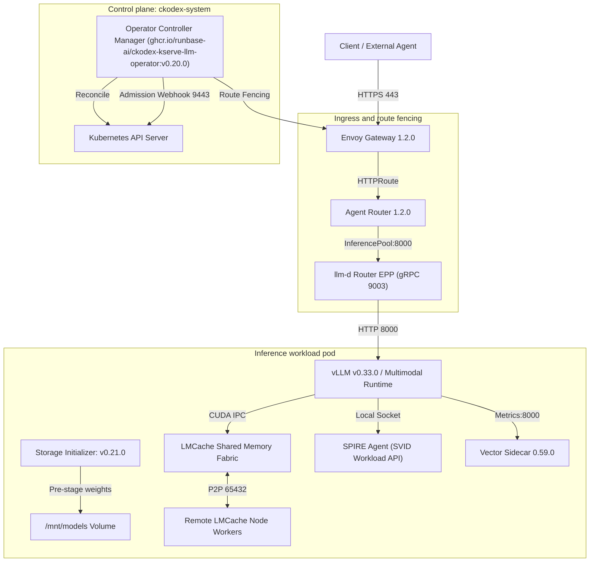

# Component catalog and subsystem boundaries

This catalog documents the runtime engines, protocol standards, data plane components, security services, and networking boundaries for release `v0.20.0` of the CKodex KServe LLM Operator.

## Component inventory

### 1. Inference engines and foundation models

| Component | Version | Image reference or source | Protocols and ports | Qualification status |
|---|---|---|---|---|
| **vLLM runtime** | `v0.33.0` | `vllm/vllm-openai:v0.33.0@sha256:d825baf9ce4b1b6bfc5ecc7b79880c7e6748c65a72d697ce3d47607aafa84c6e` | HTTP/REST 8000, Metrics 8000 | `VERIFIED` on CUDA 13.0, PyTorch 2.14.0 |
| **vLLM CPU** | `v0.33.0` | `vllm/vllm-openai-cpu:v0.33.0@sha256:87167cf0ec6e1e9607bb1cf9bf618a67d04963236a34bd955ac75b7d31a6edf5` | HTTP/REST 8000 | `VERIFIED` on linux/amd64 and linux/arm64 |
| **SGLang** | `v0.5.22` | `lmsysorg/sglang:v0.5.22@sha256:e3a4f06001a29542fc4a8638536d9ffc5eb9c9942b08603c09b19a56eae4a1ae` | HTTP/REST 8000 | `ADMITTED` (implements `ConformanceTierServed` / Tier 1 in Go adapter contract) |
| **TensorFold** | `v1.0.0` | `tensorfold/tensorfold:v1.0.0@sha256:d8e5f2a1b3c4d5e6f7a8b9c0d1e2f3a4b5c6d7e8f9a0b1c2d3e4f5a6b7c8d9e0` | HTTP/REST 8000 | `ADMITTED` |
| **Baidu Unlimited-OCR-2** | `3B` | `baidu/Unlimited-OCR-2` | HTTP/REST 8000 (`/v1/chat/completions`) | `VERIFIED` for task `ocr` with SR-SWA |
| **Meta SAM 3** | `Foundation` | `facebook/sam3` | HTTP/REST 8000 (`/v1/images/segmentations`), gRPC 9000 | `VERIFIED` for task `segmentation` |
| **Kimi-K3.1 Specimen** | `Pro Specimen` | `tiny-random/kimi-k3.1-pro` | HTTP/REST 8000 | `VERIFIED` for Kimi-K3 MoE and tool calling |

### 2. Protocol standards and tool calling

| Component | Specification | Repository or package | Purpose |
|---|---|---|---|
| **Universal Tool Calling Protocol (UTCP)** | `v1.0.1` | `internal/utcp/`, `universal-tool-calling-protocol/utcp-specification` | Direct agent tool discovery and zero-wrapper native execution (HTTP, gRPC, CLI) |
| **UTCP-MCP Bridge** | `v1.0.0` | `universal-tool-calling-protocol/utcp-mcp` | Bi-directional schema conversion between UTCP manuals and Model Context Protocol clients |
| **UTCP Go SDK** | `v1.0.1` | `internal/utcp` | Pure domain implementation of UTCP parsers, validators, and executors |

### 3. Data plane, storage, and key-value cache

| Component | Version | Image reference or resource | Protocols and ports | Role |
|---|---|---|---|---|
| **LMCache engine** | `v0.5.6` | `lmcache/lmcache:v0.5.6` | CUDA IPC, P2P TCP 65432, gRPC 65433 | Multiprocess shared memory KV cache; 85% TTFT reduction |
| **KServe storage initializer** | `v0.21.0` | `kserve/storage-initializer:v0.21.0@sha256:3a3a6a8053478c8d8d90f96fc5e54c1892c07784102dda70104374d4f89a3672` | HTTPS 443 egress | S3, GCS, and OCI weight downloads |
| **CKodex storage initializer** | `v0.1.0` | `ckodex/storage-initializer:v0.1.0` | HTTP/HTTPS | Optimized SeaweedFS and Hugging Face downloads |
| **Hugging Face CSI driver** | `v0.15.1` | `ghcr.io/huggingface/charts/hf-csi-driver:0.15.1` | FUSE / POSIX | Optional direct volume mount for Hugging Face weights |
| **SeaweedFS** | `4.47` | `chrislusf/seaweedfs:4.47` | S3 API 8333, Master 9333, Volume 8080 | Local S3-compatible model cache store |

### 4. Networking and Gateway API

| Component | Version | Image reference or resource | Protocols and ports | Role |
|---|---|---|---|---|
| **Envoy Gateway** | `v1.2.0` | `docker.io/envoyproxy/gateway:v1.2.0` | HTTP 80, HTTPS 443, Metrics 19001 | Ingress traffic management, TLS termination, route fencing |
| **Agent Router** | `v1.2.0` | `docker.io/envoyproxy/ai-gateway:v1.2.0` | HTTP 8000 | Token-aware scheduling and semantic routing |
| **Gateway API** | `v1.6.2` | Kubernetes API bundle (`gateway.networking.k8s.io/v1`) | Kubernetes API | Standardized HTTPRoute, GRPCRoute, and Gateway specifications |
| **llm-d Router EPP** | `v1.0.0` | `ghcr.io/llm-d/llm-d-router-endpoint-picker@sha256:024188e998f516879f68532016ca24fabca00afbdcc2af9a61b17634e197df2c` | gRPC 9003 | Endpoint Picker for dynamic KV-aware inference pools |

### 5. Security, identity, and compliance

| Component | Version | Reference | Ports | Role |
|---|---|---|---|---|
| **SPIRE Server** | `v1.15.4` | `ghcr.io/spiffe/spire-server:1.15.4` | gRPC 8081 | Workload identity authority and certificate issuance |
| **SPIRE Agent** | `v1.15.4` | `ghcr.io/spiffe/spire-agent:1.15.4` | Unix Domain Socket | Node-local SPIFFE Workload API |
| **SPIFFE Helper** | `v0.11.0` | `ghcr.io/spiffe/spiffe-helper:0.11.0` | Local process | Automated SVID and X.509 certificate rotation |
| **OPA Gatekeeper** | `v3.23.1` | `templates.gatekeeper.sh/v1` | HTTPS 8443 | Admission policy enforcement and GPU quota controls |
| **Istio** | `1.30.6` | Managed service mesh | TCP/mTLS 15001, 15006 | Network-level mTLS and AuthorizationPolicy enforcement |
| **Lula / OSCAL** | `v1.1.2` | NIST SP 800-53 Rev 5 component definitions | CLI / CI | Machine-readable security control validation |

## Subsystem boundary map

## Listening ports and protocols

| Subsystem | Port | Protocol | Scope | Direction | TLS / Authentication | Purpose |
|---|---|---|---|---|---|---|
| Operator manager | `8080` | HTTP | In-cluster | Inbound | Cleartext | Prometheus metrics (`/metrics`) |
| Operator manager | `8081` | HTTP | In-cluster | Inbound | Cleartext | Health probes (`/healthz`, `/readyz`) |
| Operator webhook | `9443` | HTTPS | In-cluster | Inbound | TLS (cert-manager or self-signed) | Validating and mutating webhooks |
| Envoy Gateway | `80` | HTTP | Ingress | Inbound | Cleartext (redirects to HTTPS) | Ingress HTTP entrypoint |
| Envoy Gateway | `443` | HTTPS | Ingress | Inbound | TLS 1.3 (SNI certificates) | Secure inference API entrypoint |
| vLLM / Multimodal | `8000` | HTTP | In-pod / ClusterIP | Inbound | Optional mTLS (SPIFFE/Istio) | Inference API (`/v1/chat/completions`) |
| Meta SAM 3 | `9000` | gRPC | In-pod / ClusterIP | Inbound | Optional mTLS | Segmentation service gRPC endpoint |
| llm-d Router EPP | `9003` | gRPC | In-cluster | Inbound | Mutual TLS | Endpoint Picker health and pool routing |
| LMCache multiprocess | `65432` | TCP | In-cluster | Bi-directional | Pre-shared key or mTLS | P2P remote key-value cache sync |
| LMCache control | `65433` | gRPC | In-cluster | Inbound | Token-authenticated | LMCache metadata and lookup coordination |
| SPIRE Server | `8081` | gRPC | In-cluster | Inbound | mTLS (SPIRE trust bundle) | Node registration and SVID attestation |
| SeaweedFS S3 | `8333` | HTTP | In-cluster | Inbound | AWS Signature v4 | S3 model weight bucket storage |

## End-to-end data flows

### 1. Inference request flow
1. The external client initiates an HTTPS request to `https://inference.corp.internal/v1/chat/completions`.
2. Envoy Gateway 1.2.0 terminates TLS, checks rate limits, and matches the active `HTTPRoute`.
3. If the target workload is under quarantine or safe hold, Envoy Gateway rejects the request with HTTP 503 via route fencing.
4. For active workloads, Agent Router evaluates KV-cache affinity via llm-d Router EPP on port 9003.
5. The request routes to the selected vLLM pod on port 8000.
6. vLLM checks its LMCache shared memory prefix cache; if found, cached KV tensors load directly via CUDA IPC, reducing TTFT by up to 85%.
7. The model generates response tokens and streams output back to the client.
8. HTTPRoute automatically injects security headers (`Cache-Control: no-store`, `X-Content-Type-Options: nosniff`, `Referrer-Policy: no-referrer`), while TLS, HSTS, and frame options are terminated at the edge Gateway layer.

### 2. Universal Tool Calling Protocol (UTCP v1.0.1) flow
1. The autonomous agent loads tool declarations from declared `spec.utcpManuals` on the `Agent` resource.
2. The agent fetches the tool manual from the endpoint (`GET /utcp`) or reads the embedded `AIPack` artifact (`kind: UTCPManual`).
3. When the language model emits a tool call (for example, `unlimited_ocr_parse`), the agent parses arguments against the tool input JSON schema.
4. The UTCP execution engine in `internal/utcp/executor.go` resolves the `tool_call_template`.
5. The executor dispatches a direct HTTP POST request to `http://unlimited-ocr-2.ckodex-inference.svc.cluster.local:8000/v1/chat/completions` with no intermediate wrapper proxy.
6. The target multimodal service returns parsing results; the agent injects results into the reasoning loop.
7. An Ed25519 execution receipt records the invocation parameters, hashes, and response digest.
