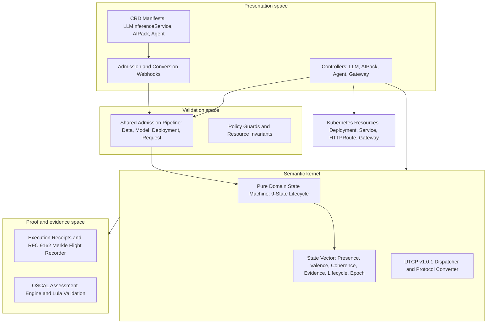

# CKodex KServe LLM Operator

[](https://goreportcard.com/report/github.com/ckodex-labs/ckodex-kserve-llm)
[](https://opensource.org/licenses/Apache-2.0)
[](docs/overview.md)
[](https://github.com/ckodex-labs/ckodex-kserve-llm/releases/tag/v0.20.0)
[](https://securityscorecards.dev/viewer/?uri=github.com/ckodex-labs/ckodex-kserve-llm)

The CKodex KServe LLM Operator automates the deployment, routing, scaling, governance, and cryptographic attestation of large language models and multimodal foundation models on Kubernetes.

For a comprehensive architectural breakdown, read [the big picture overview](docs/overview.md).

## Core capabilities in release v0.20.0

Release `v0.20.0` (commit `9da7f18`) establishes production defaults across the inference control plane:

- **vLLM v0.33.0 runtime engine**: Pinned to `vllm/vllm-openai:v0.33.0@sha256:d825baf9ce4b1b6bfc5ecc7b79880c7e6748c65a72d697ce3d47607aafa84c6e`. Built on PyTorch 2.14.0 and CUDA 13.0. Supports the Kimi-K3 architecture family (Gated-DSA, MoE, and KDA linear attention), chunked prefill, V1 engine architecture, tensor parallelism, and Ray 2.45.1 clustering.
- **Universal Tool Calling Protocol (UTCP v1.0.1)**: Pure domain protocol implementation in `internal/utcp/`. Provides native tool discovery and direct invocation over HTTP, gRPC, and CLI without proxy wrapper overhead. Includes bidirectional converters for Model Context Protocol (MCP) and OpenAPI schemas.
- **Multimodal foundation models**: Admitted `MultimodalInferenceService` tasks for Baidu Unlimited-OCR-2 (`task: ocr`, multi-page document parsing with SR-SWA) and Meta SAM 3 (`task: segmentation`, promptable concept segmentation masks).
- **LMCache v0.5.6 prefix caching**: Multiprocess shared memory key-value fabric over CUDA IPC and P2P transfers. Yields up to 85% time-to-first-token (TTFT) reduction for repeated system prompts.
- **Envoy Gateway 1.2.0 integration**: TLS termination, route fencing for quarantined workloads, and automated response security headers. HTTPRoute automatically injects `Cache-Control: no-store`, `X-Content-Type-Options: nosniff`, and `Referrer-Policy: no-referrer`, while TLS, HSTS, and frame options are terminated at the edge Gateway layer.
- **Normalized reconciler diff engine (`L-OP-018`)**: Reconciles container commands, working directories, ports, security contexts, probes, lifecycles, and pod scheduling constraints in `internal/controller/reconciler/diff.go` with API server default normalization to prevent reconciliation drift loops.
- **Consolidated Helm charts (`L-OP-013`)**: Canonical deployment chart in `deploy/helm`, with byte parity enforced against `charts/ckodex-kserve-llm-operator` through the `hack/helm-contract` verification suite.

## User roles and boundaries

| User | Inputs provided | Outputs received |
|---|---|---|
| Model scientist | Model URI, model name, accelerator resources, tool manuals | OpenAI-compatible endpoint, metrics, and readiness conditions |
| Platform engineer | Kubernetes cluster, Gateway API, storage secrets, node selectors | Governed control plane, automated reconciliation, and autoscaling |
| Security auditor | Identity policies, network boundaries, signing certificates | Cryptographic receipts, OSCAL assessments, and SLSA provenance |

## Architecture

The operator adheres to the Four Spaces architecture defined in the CKODEX Constitution:



## Quickstart

### Prerequisites

- Kubernetes cluster v1.30 or higher (Kind or cloud managed).
- `kubectl` v1.30+ and Helm v3.14+.
- NVIDIA GPU with CUDA 13.0 driver installed for GPU-accelerated workloads.

### Install the operator

Install the operator via the canonical Helm chart:

```bash
helm install ckodex-operator deploy/helm \
  --namespace ckodex-system \
  --create-namespace \
  --set image.repository=ghcr.io/runbase-ai/ckodex-kserve-llm-operator \
  --set image.tag=v0.20.0
```

Verify controller readiness:

```bash
kubectl rollout status deployment/ckodex-operator-controller-manager -n ckodex-system
```

### Deploy a specimen model

Deploy the Kimi-K3.1 specimen service using `serving.ckodex.com/v1`:

```yaml
apiVersion: serving.ckodex.com/v1
kind: LLMInferenceService
metadata:
  name: kimi-k31-specimen
  namespace: default
spec:
  model:
    name: tiny-random-kimi-k31-pro
    uri: hf://tiny-random/kimi-k3.1-pro
  replicas: 1
  template:
    spec:
      containers:
        - name: vllm
          image: vllm/vllm-openai:v0.33.0@sha256:d825baf9ce4b1b6bfc5ecc7b79880c7e6748c65a72d697ce3d47607aafa84c6e
          args:
            - --trust-remote-code
            - --enforce-eager
            - --gpu-memory-utilization=0.50
            - --enable-auto-tool-choice
            - --tool-call-parser=hermes
            - --max-model-len=8192
          resources:
            limits:
              cpu: "4"
              memory: 8Gi
              nvidia.com/gpu: "1"
  router:
    gateway:
      managed:
        gatewayClassName: envoy
    route:
      httpRoute: {}
    scheduler:
      pool: {}
```

Apply the manifest and inspect status:

```bash
kubectl apply -f config/samples/llminferenceservice_kimi_k31_specimen.yaml
kubectl get llminferenceservices.serving.ckodex.com -w
```

## Primary custom resources

The operator exposes both stable (`v1`) and specialized (`v1alpha2`) custom resource definitions:

| Resource | Version | Purpose |
|---|---|---|
| `LLMInferenceService` | `serving.ckodex.com/v1` | Core LLM serving workload managing vLLM, SGLang, and TensorFold |
| `AIPack` | `serving.ckodex.com/v1alpha2` | Declarative packaging of models, LoRA adapters, and UTCP manuals |
| `MultimodalInferenceService` | `serving.ckodex.com/v1alpha2` | Foundation vision models (Baidu Unlimited-OCR-2, Meta SAM 3) |
| `EmbeddingInferenceService` | `serving.ckodex.com/v1alpha2` | Dense embedding serving workloads |
| `ASRInferenceService` | `serving.ckodex.com/v1alpha2` | Automatic speech recognition workloads |
| `Agent` | `serving.ckodex.com/v1alpha2` | Autonomous agent identity and UTCP tool manual bindings |
| `LocalModelCache` | `serving.ckodex.com/v1alpha2` | Cluster-wide and node-local weight pre-staging |
| `ModelServingProfile` | `serving.ckodex.com/v1alpha2` | Standardized hardware and execution presets |

## Verification and compliance

Every release artifact is signed and verified through automated Dagger pipelines:

```bash
dagger call all --source=.       # Hosted fast gate: vet, lint, and build check
dagger call test --source=.      # Unit and race tests with per-package coverage gates
dagger call scan --source=.      # Trivy container vulnerability scan
dagger call lula --source=. export --path=assessment-results.yaml  # OSCAL assessment
```

Run contract checks locally:

```bash
go test -count=1 ./hack/helm-contract/...
go test -count=1 ./hack/public-release-contract/...
```

## Documentation index

| Topic | Reference guide |
|---|---|
| Complete architecture | [docs/overview.md](docs/overview.md) |
| Component catalog and ports | [COMPONENTS.md](COMPONENTS.md) |
| Zero-trust security | [docs/SECURITY_ARCHITECTURE.md](docs/SECURITY_ARCHITECTURE.md) |
| Disconnected air-gap operations | [docs/AIRGAP.md](docs/AIRGAP.md) |
| Universal Tool Calling Protocol | [docs/utcp-integration-guide.md](docs/utcp-integration-guide.md) |
| Operator v0.20.0 upgrade runbook | [docs/runbooks/v0.20.0-upgrade.md](docs/runbooks/v0.20.0-upgrade.md) |
| UTCP tools operational runbook | [docs/runbooks/utcp-tools-operations.md](docs/runbooks/utcp-tools-operations.md) |
| Multimodal inference runbook | [docs/runbooks/multimodal-inference.md](docs/runbooks/multimodal-inference.md) |
| LMCache operational runbook | [docs/runbooks/lmcache.md](docs/runbooks/lmcache.md) |
| Runtime engine contract | [docs/engine-contract.md](docs/engine-contract.md) |
| Workload configuration defaults | [docs/operator-defaults.md](docs/operator-defaults.md) |
| NIST SP 800-53 and OSCAL | [COMPLIANCE.md](COMPLIANCE.md) |
| Agent coding guidelines | [AGENTS.md](AGENTS.md) |

## Project status and governance

- Release version: `v0.20.0`
- Git commit: `9da7f18`
- Default operator container: `ghcr.io/runbase-ai/ckodex-kserve-llm-operator:v0.20.0`
- Governance standard: CKODEX Agent Engineering Constitution (Level 5 Assured Conformance)

## License

Licensed under the Apache License, Version 2.0. See [LICENSE](LICENSE) for details.
