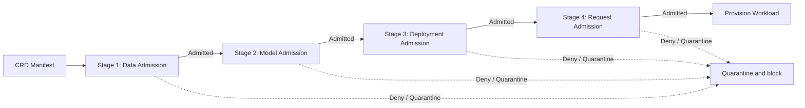

# Security architecture and zero-trust governance

The CKodex KServe LLM Operator enforces a zero-trust security architecture across the entire model serving lifecycle. The security model guarantees that every consequential operation on model weights, network routes, compute resources, and tool executions requires explicit authority, admission validation, and cryptographic attestation.

## Authority hierarchy and capability leases

Governed entities never self-authorize. All authority flows through a strict hierarchical standing-authority model:

```text
Root Authority
  └── Tenant
       └── Namespace
            └── Workspace
                 └── Environment
                      └── Project
                           └── Resource (LLMInferenceService, AIPack, Agent)
```

Possession of credentials or network co-location does not constitute authorization. Every consequential operation requires an active `CapabilityLease`:
- **Explicit scope**: Bounded to specific model actions (read, infer, hot-swap, delete).
- **Attenuated rights**: Child capabilities cannot exceed parent authority.
- **Time-bounded expiry**: Leases carry monotonic deadlines; expired leases automatically revoke authority.
- **Revocability**: Security controllers can revoke leases instantly via the reconciliation loop.
- **Cryptographic proof**: Signed using Ed25519; verification receipts are committed to the flight recorder.

## Workload identity with SPIFFE/SPIRE

Workload identity eliminates static credentials and API keys across the data plane:
- **SPIFFE IDs**: Assigned per inference service formatted as `spiffe://<trust-domain>/ns/<namespace>/sa/<serviceaccount>/model/<model-name>`.
- **SPIRE Agent and Server**: SPIRE Agent runs node-locally as a DaemonSet; SPIRE Server acts as the cluster identity authority.
- **SVID Issuance**: The `SPIREReconciler` in `internal/security/spire_reconciler.go` coordinates with SPIRE to issue X.509 SVIDs (SPIFFE Verifiable Identity Documents) directly to workload pods via a local Unix domain socket.
- **Mutual TLS (mTLS)**: Workloads enforce strict mTLS for pod-to-pod and gateway-to-workload communication, rotating certificates every 60 minutes automatically without pod restarts.

## Four-stage admission pipeline

All model serving declarations pass through a composable four-stage admission pipeline before compute resources are provisioned:



1. **Data admission**: Validates artifact provenance, checksum integrity, and license compliance. Verifies Cosign signatures against trusted public keys.
2. **Model admission**: Evaluates tensor structure and serialization format. Restricts unsafe formats (such as arbitrary pickle files) and enforces safetensors or verified GGUF/AWQ tensors. Scans model metadata for embedded malicious payloads.
3. **Deployment admission**: Validates accelerator quotas, VRAM requirements, container security contexts, node selectors, and tenant isolation policies.
4. **Request admission**: Enforces rate limits, tenant token allowances, and payload constraints before requests reach model worker pods.

### Categorical admission dispositions

Validation produces one of six explicit categorical decisions:
- `ADMIT`: All checks pass unconditionally; execution proceeds.
- `ADMIT_WITH_OBLIGATIONS`: Admitted subject to runtime obligations (for example, mandatory audit logging or restricted egress).
- `DENY`: Hard rejection due to policy or invariant failure.
- `ESCALATE`: Requires human or security officer intervention before lease grant.
- `SAFE_HOLD`: Workload frozen in place; forensic state and evidence preserved.
- `QUARANTINE`: Total isolation; network egress severed and resources locked.

## Container runtime hardening

All operator and workload containers conform to strict least-privilege standards:
- **Distroless base images**: Operator binaries compile into distroless static scratch containers containing zero shell binaries, package managers, or interpreters.
- **Non-root execution**: Workloads run explicitly as unprivileged user `nonroot` (UID 65532, GID 65532).
- **Read-only root filesystem**: All container root filesystems are mounted read-only (`readOnlyRootFilesystem: true`). Ephemeral state is restricted to explicit `emptyDir` memory volumes.
- **Dropped capabilities**: All Linux capabilities are dropped (`capabilities.drop: ["ALL"]`). Privileged mode and host namespace sharing are forbidden.
- **Seccomp and AppArmor**: Default `RuntimeDefault` seccomp profiles restrict system calls.

## Supply chain security and cryptographic attestation

The operator incorporates verifiable supply chain security across all release assets:
- **Cosign OIDC signatures**: All published container images are signed via GitHub Actions OIDC federation using Sigstore Cosign.
- **SLSA provenance Level 3**: Build pipelines emit signed SLSA provenance attestation files recording the exact source commit, builder identity, and input dependencies.
- **Software Bill of Materials (SBOM)**: Every image generates CycloneDX and SPDX SBOMs recording all compiled Go modules and Python dependencies.
- **Vulnerability scanning**: Images must pass Trivy scans with zero `CRITICAL` or `HIGH` vulnerabilities prior to release publication.

## Ingress security with Envoy Gateway 1.2.0

Edge network communication is secured through Envoy Gateway 1.2.0:
- **TLS termination**: Enforces TLS 1.3 with forward secrecy. Rejects outdated ciphers and SSL/TLS versions.
- **Route fencing**: When a workload enters `SAFE_HOLD` or `QUARANTINED`, `internal/gateway/fence.go` modifies the corresponding `HTTPRoute` and `GRPCRoute` within 5 seconds, stripping all backend forwarders while retaining matching rules. This drops external traffic instantly without deleting customer routing objects.
- **Mandatory security response headers**: HTTPRoute automatically injects `Cache-Control: no-store`, `X-Content-Type-Options: nosniff`, and `Referrer-Policy: no-referrer`, while TLS, HSTS, and frame options are terminated at the edge Gateway layer.

## Compliance as code: OSCAL and Lula

Continuous compliance is verified against NIST SP 800-53 Rev 5:
- **Component definitions**: `oscal/component-definition.yaml` maps operator controls to NIST controls (AC-4, AU-2, CA-7, IA-9, SC-7, SC-8, SI-4, SI-7, SR-2, SR-4).
- **Live assessment tool**: `hack/oscal-assessment` evaluates cluster resources against declared control targets and outputs structured JSON observations.
- **Lula verification**: CI pipelines validate machine-readable evidence using Lula:
  ```bash
  dagger call lula --source=. export --path=assessment-results.yaml
  ```

## Vector state defensive posture

Defensive posture is tracked continuously as a 6D state vector:

$$S(e,t) = \langle P, V, C, E, L, \tau \rangle$$

When active exploitation, signature mismatch, or policy contradiction occurs, coherence immediately collapses from `COHERENT` to `DECOHERENT`. The reconciler fences network routes, transitions lifecycle to `QUARANTINED`, and records an immutable receipt in the RFC 9162 Merkle flight recorder for post-incident audit.
