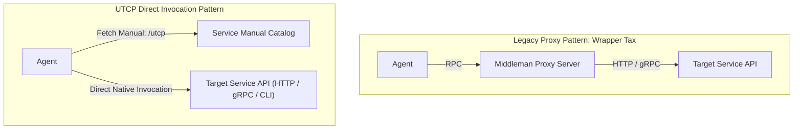
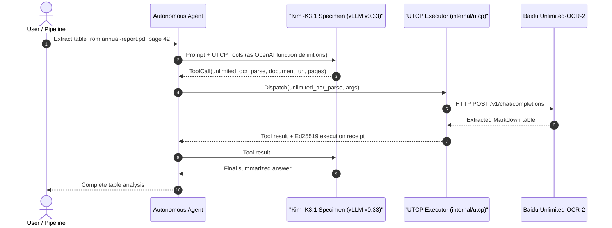

# Universal Tool Calling Protocol integration guide

The Universal Tool Calling Protocol (UTCP v1.0.1) is an open specification enabling AI models and autonomous agents to discover, inspect, and invoke tools directly over native transports (HTTP, gRPC, CLI) without deploying intermediate proxy wrapper servers.

This guide details the UTCP architecture, manual schema authoring, bidirectional converters for Model Context Protocol (MCP) and OpenAPI, and Kubernetes CRD integration using `Agent` and `AIPack`.

## Core architectural philosophy

Traditional tool calling architectures (such as standard MCP deployments) introduce an operational "wrapper tax": engineers must build, containerize, host, and maintain dedicated proxy microservices simply to expose existing APIs to agents.



UTCP enforces a direct communication model: if a service already exposes an authenticated HTTP, gRPC, or CLI interface, an autonomous agent can invoke that interface natively. The tool manual provides the deterministic schema and calling template.

## UTCP v1.0.1 schema specification

A tool provider exposes a standardized JSON manifest called a **Manual**, conventionally served at `GET /utcp` or packaged in an `AIPack` artifact.

### Manual schema definition

```json
{
  "utcp_version": "1.0.1",
  "manual_version": "1.0.0",
  "info": {
    "title": "Document and Vision Capabilities",
    "description": "Native tools for multi-page OCR and promptable concept segmentation",
    "version": "1.0.0"
  },
  "tools": [
    {
      "name": "unlimited_ocr_parse",
      "description": "Parse long-horizon multi-page documents with Baidu Unlimited-OCR-2",
      "inputs": {
        "type": "object",
        "properties": {
          "document_url": { "type": "string" },
          "pages": { "type": "array", "items": { "type": "integer" } }
        },
        "required": ["document_url"]
      },
      "tool_call_template": {
        "call_template_type": "http",
        "url": "http://unlimited-ocr-2.ckodex-inference.svc.cluster.local:8000/v1/chat/completions",
        "http_method": "POST",
        "headers": {
          "Content-Type": "application/json"
        }
      },
      "tags": ["vision", "ocr"]
    },
    {
      "name": "sam3_segment_concept",
      "description": "Generate concept-guided segmentation masks with Meta SAM 3",
      "inputs": {
        "type": "object",
        "properties": {
          "image_url": { "type": "string" },
          "concept": { "type": "string" }
        },
        "required": ["image_url", "concept"]
      },
      "tool_call_template": {
        "call_template_type": "grpc",
        "endpoint": "sam3.ckodex-inference.svc.cluster.local:9000",
        "service": "sam3.SegmentationService",
        "method": "SegmentConcept"
      },
      "tags": ["vision", "segmentation"]
    }
  ]
}
```

### Call template types

The `tool_call_template` defines the transport protocol in `internal/utcp/types.go`:
- `http`: REST or HTTP APIs. Declares `url`, `http_method` (`GET`, `POST`, `PUT`, `DELETE`), optional `headers`, `query_params`, and `body`.
- `grpc`: High-throughput binary RPCs. Declares `endpoint`, `service`, `method`, and optional `proto` definition.
- `cli`: Node-local utilities. Declares `command`, `args`, and `env` mappings.
- `websocket` / `sse`: Streaming data transports.

## Packaging tool manuals as AIPacks

In Kubernetes, manuals can be distributed as immutable OCI artifacts via the `AIPack` CRD:

```yaml
apiVersion: serving.ckodex.com/v1alpha2
kind: AIPack
metadata:
  name: aipack-unlimited-ocr-utcp
  namespace: default
  labels:
    aipack.ckodex.com/kind: UTCPManual
    aipack.ckodex.com/family: capability
spec:
  kind: UTCPManual
  family: capability
  source:
    ref: registry.corp.internal/aipack/unlimited-ocr-utcp@sha256:d825baf9ce4b1b6bfc5ecc7b79880c7e6748c65a72d697ce3d47607aafa84c6e
    mediaType: application/vnd.ai.utcpmanual.v1+json
  utcpManual:
    utcpVersion: "1.0.1"
    manualVersion: "1.0.0"
    endpoint: http://unlimited-ocr-2.ckodex-inference.svc.cluster.local:8000/utcp
```

The operator validates artifact digests and mounts manuals into agent workloads without external network access.

## Declaring tools on autonomous agents

Agents bind to UTCP manuals or individual native tools using the `Agent` CRD:

```yaml
apiVersion: serving.ckodex.com/v1alpha2
kind: Agent
metadata:
  name: document-analyst-agent
  namespace: default
spec:
  identity:
    name: Document Analyst Agent
    description: Autonomous analyst equipped with UTCP OCR and segmentation tools
    version: 1.0.0
  modelRef: kimi-k31-specimen
  utcpManuals:
    - name: vision-tools
      endpoint: http://utcp-catalog.default.svc.cluster.local/utcp
    - name: ocr-manual
      packRef: aipack-unlimited-ocr-utcp
  tools:
    - name: unlimited_ocr_parse
      description: Parse long-horizon documents with Baidu Unlimited-OCR-2
      protocol: utcp
      endpoint: http://unlimited-ocr-2.ckodex-inference.svc.cluster.local:8000/v1/chat/completions
      inputSchema: |
        {
          "type": "object",
          "properties": {
            "document_url": {"type": "string"},
            "pages": {"type": "array", "items": {"type": "integer"}}
          },
          "required": ["document_url"]
        }
  maxTokens: 4096
```

## Bidirectional protocol converters

The Go engine in `internal/utcp/converter.go` provides zero-loss schema translations across agent ecosystems:

### 1. Converting UTCP to OpenAI tool format
Transforms a UTCP manual into the function definitions expected by vLLM or OpenAI-compatible models:

```go
openAITools := utcp.ToOpenAITools(manual)
```

Each tool translates into:
```json
{
  "type": "function",
  "function": {
    "name": "unlimited_ocr_parse",
    "description": "Parse long-horizon multi-page documents...",
    "parameters": { ... }
  }
}
```

### 2. Converting UTCP to Model Context Protocol (MCP)
Allows standard MCP clients (such as Claude Desktop or Cursor) to consume native UTCP tools:

```go
mcpTools := utcp.ToMCPTools(manual)
```

The MCP client interacts with the `utcp-mcp` bridge, which dispatches requests natively according to the manual template without maintaining separate backend adapter servers.

## End-to-end execution flow



## Verification and error handling

The executor in `internal/utcp/executor.go` validates inputs against the declared JSON schema prior to transmission:
- If required parameters are missing, execution halts and returns a schema validation error before generating network traffic.
- If the remote endpoint returns a non-2xx status code, the executor captures the response body and emits an error receipt.
- Network timeouts default to 30 seconds unless overridden in the tool manual template.
