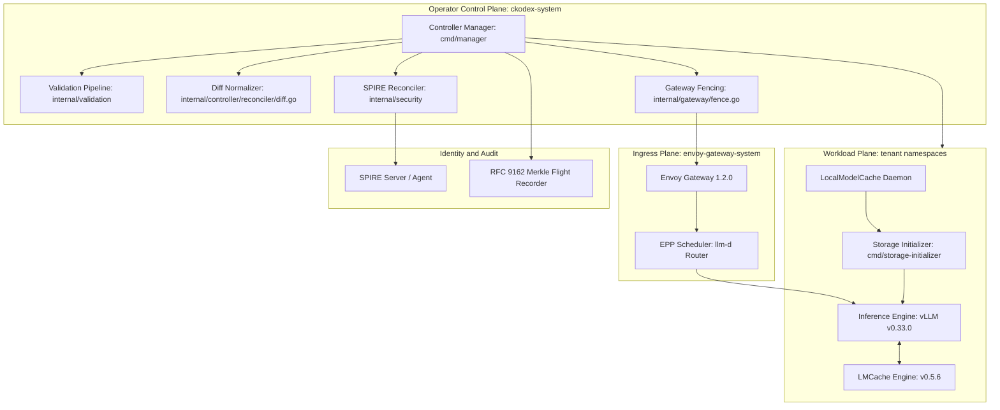
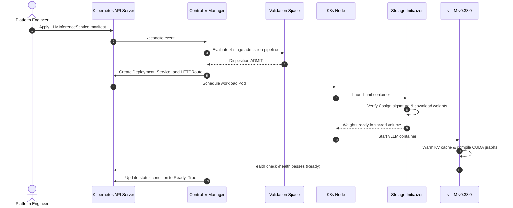
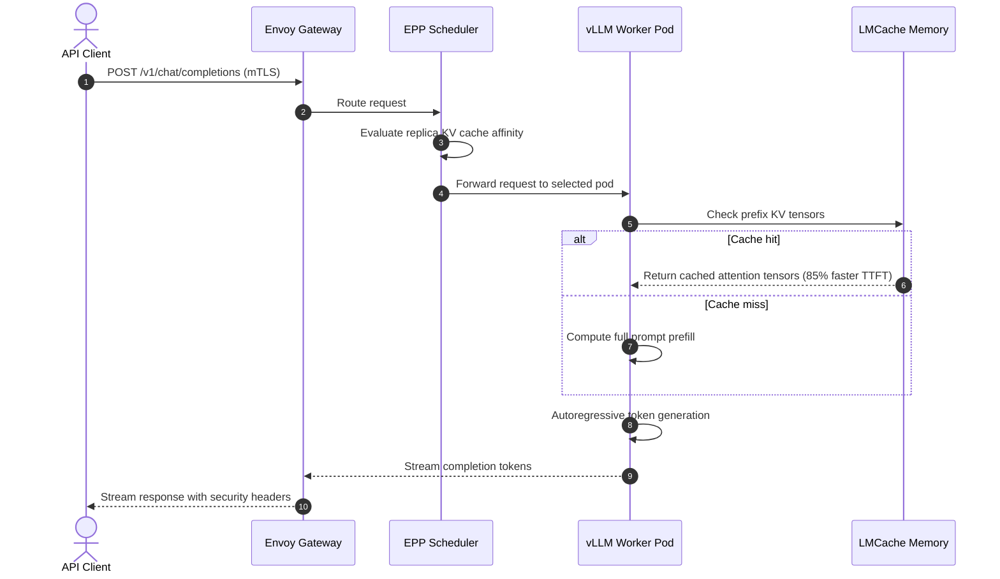
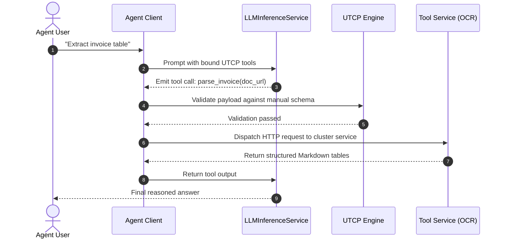
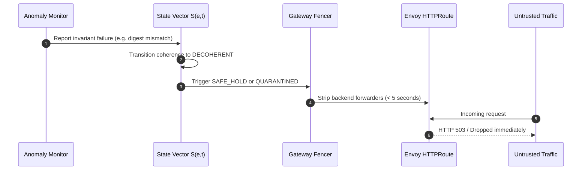

# Component catalog and data flows

This document details the system components of the CKodex KServe LLM Operator and traces the four primary data flows across the control and data planes.

## Component catalog

### 1. Controller manager (`cmd/manager/main.go`, `internal/controller/`)
The central Kubernetes operator process. Hosts reconcilers for:
- `LLMInferenceService`: Reconciles deployments, services, and routes for text and chat models.
- `AIPack`: Manages immutable OCI artifact admission and verification across 16 kinds.
- `MultimodalInferenceService`: Deploys OCR (Baidu Unlimited-OCR-2) and segmentation (Meta SAM 3) models.
- `Agent`: Reconciles agent identity, tool manuals, and skill bindings.
- `LocalModelCache`: Pre-stages model weights to node NVMe storage.

### 2. Storage initializers (`cmd/storage-initializer/`, `cmd/huggingface-initializer/`)
Init containers executed before the inference engine starts:
- Standard storage initializer: Downloads weights from S3, GCS, or OCI registries.
- Hugging Face initializer: Authenticates against Hugging Face, downloads repository checkpoints, and verifies Cosign signatures.
- Local cache binder: Detects existing `LocalModelCache` paths and binds local storage directly.

### 3. Gateway and routing plane (`internal/gateway/`)
Coordinates ingress traffic through Gateway API v1.6.2 and Envoy Gateway 1.2.0:
- HTTPRoute and GRPCRoute provisioning.
- Automated security response headers injection (`Cache-Control: no-store`, `X-Content-Type-Options: nosniff`).
- Route fencing engine (`fence.go`): Strips routing forwarders within 5 seconds during security incidents while preserving route rules.

### 4. Scheduler and KV cache fabric
- **EPP Scheduler (`llm-d Router`)**: Provides KV-cache-aware scheduling across replicas by monitoring queue depths and cache factors.
- **LMCache Engine v0.5.6**: Manages in-process connectors (`LMCacheConnectorV1`) or node-local shared-memory daemons via CUDA IPC and `/dev/shm`.

### 5. Universal Tool Calling Protocol engine (`internal/utcp/`)
Pure Go protocol implementation:
- Validates UTCP v1.0.1 manuals against strict JSON schemas.
- Converts between UTCP manuals, OpenAI tool formats, and Model Context Protocol (MCP) servers.
- Enforces security boundaries on tool execution templates.

### 6. Workload identity and cryptographic audit
- **SPIRE Agent and Server**: Issues short-lived X.509 SVIDs directly to pods over a local Unix domain socket for mutual TLS.
- **RFC 9162 Merkle Flight Recorder**: Emits signed Ed25519 receipts for state mutations and admission decisions into an append-only cryptographic ledger.

---

## Primary data flows

### 1. Workload deployment flow

### 2. Inference request flow

### 3. Autonomous agent tool execution flow

### 4. Route fencing flow

## Next steps

- [Consult the Four Spaces architecture overview](overview.md)
- [Review security architecture and capability leases](security-architecture.md)
- [Learn compliance verification with OSCAL](compliance-oscal.md)
