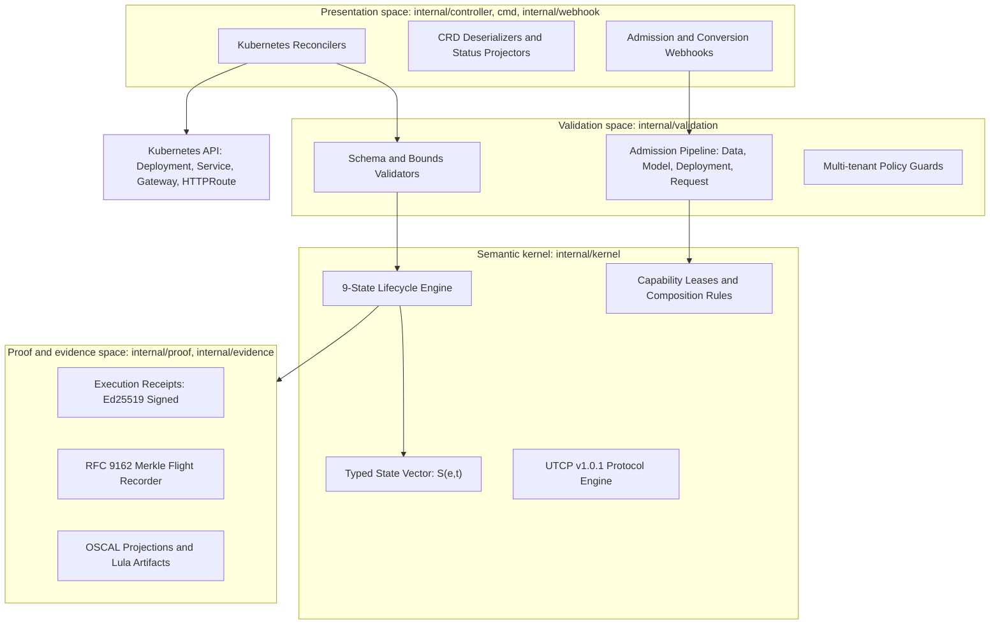
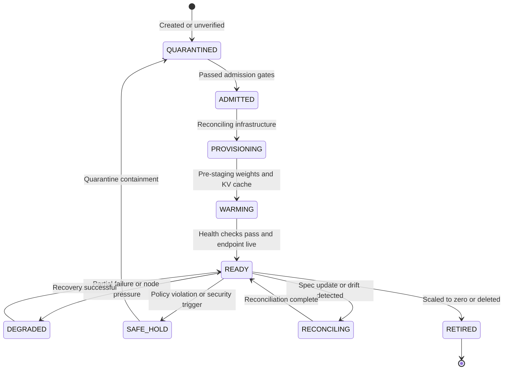

# Architecture and the four spaces

The CKodex KServe LLM Operator coordinates the deployment, routing, scaling, identity, and cryptographic attestation of large language models and multimodal foundation models on Kubernetes.

The operator does not train models and does not replace inference runtimes like vLLM. It reconciles declarative intent into Kubernetes runtime resources while enforcing platform policies, admission gates, and cryptographic evidence generation.

## Actor roles and responsibilities

| Actor | Primary ownership | Primary interface |
|---|---|---|
| Model scientist | Model selection, artifact URI, compute requirements, tool definitions | `LLMInferenceService`, `MultimodalInferenceService`, `Agent` |
| Platform engineer | Cluster infrastructure, GPU nodes, storage credentials, Gateway API, autoscaling | Helm charts, operator configuration, Dagger CI pipelines |
| Security auditor | Workload identity, network policy, admission gates, attestation | Cryptographic receipts, OSCAL assessments, Lula validation |

## Architectural four spaces

The codebase strictly enforces the Four Spaces architecture established in the CKODEX Constitution. Dependencies point inward toward the Semantic Kernel.

### 1. Semantic kernel (`internal/kernel/`)
The Semantic Kernel contains pure domain logic and execution semantics. It owns:
- Lifecycle state transitions and invariants.
- Typed state vector computations.
- Universal Tool Calling Protocol (UTCP v1.0.1) engine.
- Capability lease abstractions.

The Semantic Kernel has zero dependencies on Kubernetes, cloud SDKs, databases, gRPC, HTTP, or specific telemetry providers.

### 2. Validation space (`internal/validation/`)
Shared validation owns deterministic policy evaluation across the control plane. Controllers and webhooks invoke this space directly:
- Four-stage admission pipeline: Data, Model, Deployment, and Request admission.
- Six categorical admission decisions: `ADMIT`, `ADMIT_WITH_OBLIGATIONS`, `DENY`, `ESCALATE`, `SAFE_HOLD`, and `QUARANTINE`.
- Structural and semantic boundary validation for accelerator allocations, context lengths, and network routes.

### 3. Presentation space (`internal/controller/`, `cmd/`, `internal/webhook/`)
The Presentation Space maps desired custom resources to physical Kubernetes resources. It owns:
- Reconcilers for `LLMInferenceService`, `AIPack`, `MultimodalInferenceService`, `Agent`, and `Gateway`.
- Pod and container field diff normalization (`internal/controller/reconciler/diff.go`).
- Status condition projection and event logging.

Controllers contain no business logic and no independent validation logic that bypasses `internal/validation/`.

### 4. Proof and evidence space (`internal/proof/`, `internal/evidence/`)
Evidence generation is cross-cutting and decoupled from domain execution:
- Cryptographic execution receipts signed with Ed25519.
- Four truth channels: Telemetry trace, Execution trace, Decision trace, and Evidence trace.
- RFC 9162 Merkle flight recorder for immutable audit trails.
- OSCAL (Open Security Controls Assessment Language) projection and Lula verification.

## Governed lifecycle state machine

Every managed workload progresses through a 9-state deterministic lifecycle managed by the Semantic Kernel:

### Lifecycle states

1. **QUARANTINED**: Initial state for unverified workloads or workloads isolated following policy contradictions. Network egress is blocked.
2. **ADMITTED**: Workload passed all four admission stages (Data, Model, Deployment, Request) with cryptographic verification.
3. **PROVISIONING**: Controllers create deployments, services, and routing constructs.
4. **WARMING**: Weights downloaded from storage or local cache (`LocalModelCache`), GPU graphs compiled, and KV caches allocated.
5. **READY**: Endpoint passes `/health` probes and serves inference traffic through Gateway API.
6. **DEGRADED**: Pod or engine experiences reduced capacity (for example, GPU node failover or cache eviction) but continues serving under residual guarantees.
7. **SAFE_HOLD**: Workload frozen due to detected anomaly or telemetry threshold violation while forensic evidence is preserved.
8. **RECONCILING**: Spec mutations applied; reconciler converges active deployment to target state without downtime.
9. **RETIRED**: Clean termination; resources removed, GPU memory reclaimed, and final execution receipt recorded.

## Vector state model

Rather than relying on boolean status flags, the operator represents system truth as a 6-dimensional typed state vector:

$$S(e,t) = \langle P, V, C, E, L, \tau \rangle$$

- **Presence ($P$)**: `EMPTY`, `PRESENT`, `UNKNOWN`, `REDACTED`. Distinguishes absent data from negative data.
- **Valence ($V$)**: `POSITIVE`, `NEGATIVE`, `NEUTRAL`, `MIXED`. Directional impact of observations on operational hypotheses.
- **Coherence ($C$)**: `COHERENT`, `PARTIALLY_COHERENT`, `DECOHERENT`, `RECONCILING`. Indicates whether runtime state matches declared specifications.
- **Evidence ($E$)**: `OBSERVED`, `VERIFIED`, `INFERRED`, `UNKNOWN`, `CONTRADICTED`. Establishes the epistemic strength of status claims.
- **Lifecycle ($L$)**: Current state within the 9-state lifecycle machine (`QUARANTINED` through `RETIRED`).
- **Epoch ($\tau$)**: Monotonically increasing revision counter preventing state replay and race conditions.

When an anti-invariant occurs (such as an admitted digest mismatching a running container digest), coherence transitions to `DECOHERENT`. The system initiates safe hold or quarantine immediately.

## Next steps

- [Understand security architecture and zero-trust governance](security-architecture.md)
- [Explore the component catalog and data flows](components.md)
- [Learn compliance as code with OSCAL](compliance-oscal.md)
