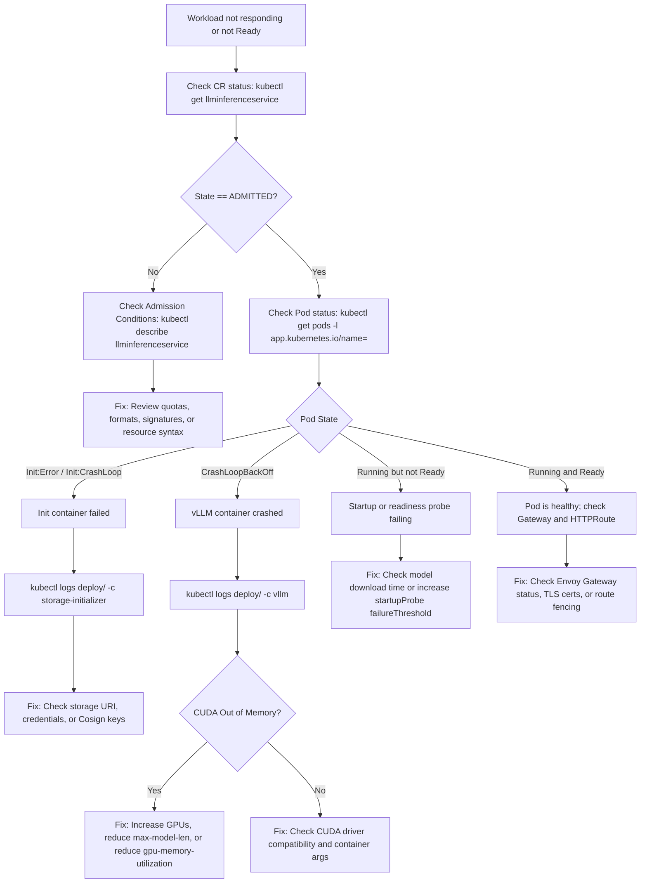

# Troubleshoot inference workload failures

This guide provides a structured diagnostic decision tree and actionable recipes to resolve common failure modes in workloads managed by the operator.

## Diagnostic decision tree

Use this flowchart to identify the failing layer:



## Symptom 1: CrashLoopBackOff with CUDA out of memory

### Symptom
The vLLM container exits repeatedly. Pod logs emit:
```text
torch.cuda.OutOfMemoryError: CUDA out of memory. Tried to allocate 2.40 GiB
```

### Cause
The model weights plus KV cache allocation exceed physical GPU VRAM.

### Remediation
1. **Reduce GPU memory utilization factor**: Lower `VLLM_GPU_MEMORY_UTILIZATION` from `0.90` to `0.80` or `0.75` in container environment variables.
2. **Limit maximum context length**: Set `--max-model-len=4096` (or lower) in container arguments.
3. **Enable FP8 KV cache**: Set `--kv-cache-dtype=fp8` to halve the memory footprint of KV tensors.
4. **Scale tensor parallelism**: Increase `--tensor-parallel-size` across multiple GPUs (for example, from 1 to 2 or 4).

## Symptom 2: Storage initializer failure

### Symptom
Pod remains stuck in `Init:CrashLoopBackOff` or `Init:Error`. The `storage-initializer` logs report:
```text
Error downloading model weights: 401 Unauthorized or Signature verification failed
```

### Cause
- Missing or invalid Hugging Face token for gated models.
- Cosign signature verification failed against the local public key.
- Object storage bucket unreachable or credentials missing.

### Remediation
1. Verify the secret containing the Hugging Face token exists in the workload namespace:
   ```bash
   kubectl get secret hf-token -n <namespace>
   ```
2. Test network egress or private registry reachability from within the cluster:
   ```bash
   kubectl run test-curl --rm -it --image=curlimages/curl -- curl -I https://huggingface.co
   ```
3. If running in air-gapped mode, confirm `CKODEX_LOCAL_COSIGN_KEY_PATH` points to a valid public key and the artifact was signed with the corresponding private key.

## Symptom 3: Gateway returns HTTP 503 or 504

### Symptom
Client requests to the external ingress endpoint fail with `HTTP 503 Service Unavailable` or `HTTP 504 Gateway Timeout`.

### Cause
- The workload is in `SAFE_HOLD` or `QUARANTINED`, triggering route fencing.
- Workload pods failed readiness probes.
- Envoy Gateway cannot route to the backend service.

### Remediation
1. Check the custom resource lifecycle state:
   ```bash
   kubectl get llminferenceservice <name> -o jsonpath='{.status.state}'
   ```
   If the state is `QUARANTINED` or `SAFE_HOLD`, inspect `.status.conditions` for the triggering policy violation.
2. Check if route fencing is active on the HTTPRoute:
   ```bash
   kubectl get httproute <name> -o yaml
   ```
   A fenced route drops backends while preserving matching rules.
3. Inspect Envoy Gateway proxy access logs:
   ```bash
   kubectl logs -n envoy-gateway-system -l app.kubernetes.io/name=envoy --tail=50
   ```

## Symptom 4: Startup probe timeout on large models

### Symptom
Pod enters `CrashLoopBackOff` after 5 to 10 minutes with event:
```text
Startup probe failed: HTTP probe failed with statuscode: 503
```

### Cause
Large model weights (such as 70B models) take longer to load and warm up than the default startup probe timeout allows.

### Remediation
Add custom startup probe thresholds to the container specification:

```yaml
spec:
  template:
    spec:
      containers:
        - name: vllm
          startupProbe:
            httpGet:
              path: /health
              port: 8000
            initialDelaySeconds: 60
            periodSeconds: 15
            failureThreshold: 60
```
This configuration permits up to 15 minutes (60 seconds initial delay + 60 * 15 seconds) for initial weight loading.

## Symptom 5: UTCP tool execution failure

### Symptom
Agent client reports `UTCPValidationError` or `UTCPDispatchError`.

### Cause
- Input arguments generated by the model fail schema validation against `inputs`.
- The target tool endpoint is unreachable due to NetworkPolicy or incorrect service DNS.

### Remediation
1. Test target endpoint DNS and connectivity from within the agent pod:
   ```bash
   kubectl exec -it deploy/<agent-pod> -- curl -v http://unlimited-ocr-2.ckodex-inference.svc.cluster.local:8000/health
   ```
2. Verify that NetworkPolicies allow cross-namespace traffic between the agent namespace and the inference namespace:
   ```bash
   kubectl get networkpolicy -A
   ```
3. Inspect operator controller manager logs for admission validation warnings:
   ```bash
   kubectl logs -n ckodex-system -l control-plane=controller-manager -c manager | grep -i utcp
   ```

## Next steps

- [Consult the CRD specification](../reference/crds.md)
- [Review operator defaults](../reference/operator-defaults.md)
- [Inspect the CLI cheat sheet](../reference/cheat-sheet.md)
